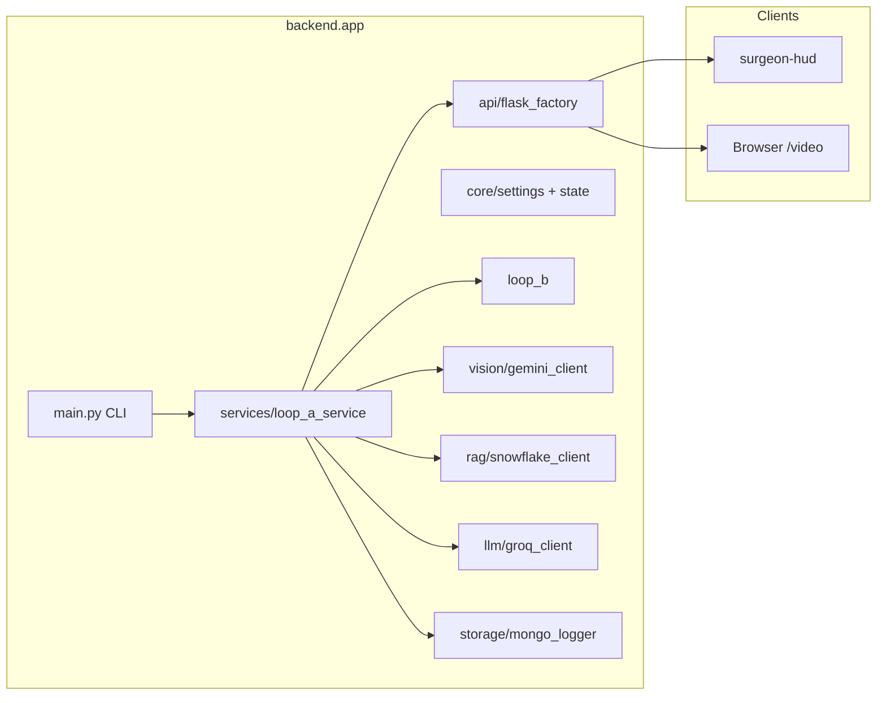

# SurgeAI — Architecture

## High-level diagram

## Layers

| Layer | Location | Responsibility |
|-------|----------|----------------|
| **Entry** | [`backend/app/main.py`](../backend/app/main.py) | CLI: constructs `LoopAService` and runs |
| **Service** | [`backend/app/services/loop_a_service.py`](../backend/app/services/loop_a_service.py) | Orchestrates capture thread, VLM loop, optional Loop B audio thread, Socket.IO |
| **HTTP / realtime** | [`backend/app/api/flask_factory.py`](../backend/app/api/flask_factory.py) | Flask app factory, `/health`, `/session/state`, MJPEG `/video` |
| **Core** | [`backend/app/core/`](../backend/app/core/) | `Settings` (`load_settings`), `SharedState` |
| **Contracts** | [`backend/app/contracts/`](../backend/app/contracts/) | Event envelopes (`make_event`), HTTP DTOs |
| **Integrations** | `vision/`, `llm/`, `rag/`, `audio/`, `storage/` | Gemini, Groq, Snowflake RAG, TTS, MongoDB |
| **Loop B (voice)** | [`backend/app/loop_b/`](../backend/app/loop_b/) | Wake word, STT, Cortex RAG + Groq Q&A, ElevenLabs playback, optional session Mongo writes |

Root-level `audio_pipeline.py` (etc.) **re-export** the same modules from `backend.app.loop_b` so legacy scripts (`merged_backend.py`, tests) keep stable import paths.

## Loop A vs Loop B

- **Loop A:** Camera → JPEG buffer → throttled `GeminiVisionClient.analyze_scene` → `StepTracker` → Snowflake `fetch_context` + Groq `generate_guidance` → guidance TTS → `SharedState` + Mongo `loop_a_step` + Socket.IO (`step_update`, `warning`, `clear`, `system_health`, `vlm_update`).
- **Loop B:** Microphone → “Hey Surgeon” → question STT → `retrieve_context` + `generate_answer` → Socket.IO `qa_update` → `speak` (ElevenLabs) → Mongo `qa_session`.

## Optional FastAPI app

[`backend/app/api/fastapi_app.py`](../backend/app/api/fastapi_app.py) runs an async WebSocket + audio listener for experiments. Production demos use **Flask** (`python -m backend.app.main`).

## Configuration

All production settings are loaded in [`backend/app/core/settings.py`](../backend/app/core/settings.py) from `backend/.env` (and process environment). [`backend/app/config.py`](../backend/app/config.py) re-exports for backward compatibility.
