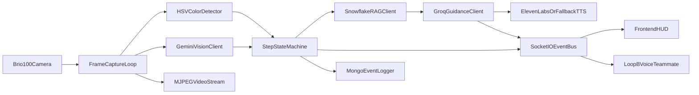

# SurgeonAI Backend Master Plan (Loop A Owner)

## Mission

Build a reliable **Loop A backend** for SurgeonAI that can run the full live demo (camera -> analysis -> grounded guidance -> speech -> HUD events) while exposing clean contracts so both teammates can integrate independently:
- Teammate A: Loop B voice Q&A pipeline
- Teammate B: Frontend HUD integration

## Scope And Ownership

- You own **Loop A** end-to-end:
  - camera ingestion and annotation
  - scene understanding and step progression
  - RAG-grounded guidance generation
  - spoken guidance output
  - backend event APIs and persistence
- Teammate A owns **Loop B**:
  - wake word, question capture, Q&A generation
  - emits `qa_update` using shared contracts
- Teammate B owns **frontend HUD**:
  - video render, step tracker, warning banner, Q&A panel
  - consumes your backend contracts only (no backend changes needed)

## Target Backend Architecture

## Canonical Project Layout (Loop A first)

- Create `backend/` project root with:
  - `backend/app/main.py` (process entrypoint; starts Loop A scheduler + Flask app)
  - `backend/app/config.py` (`.env` loading + validation)
  - `backend/app/state.py` (shared state object, current step, last warning, heartbeat)
  - `backend/app/vision/camera.py` (Brio capture + index probing)
  - `backend/app/vision/color_detection.py` (HSV red/blue/green masks for demo props)
  - `backend/app/vision/gemini_client.py` (frame -> structured JSON)
  - `backend/app/logic/step_tracker.py` (4-step state machine)
  - `backend/app/rag/snowflake_client.py` (context retrieval)
  - `backend/app/llm/groq_client.py` (guidance synthesis)
  - `backend/app/audio/tts.py` (ElevenLabs primary + pyttsx3 fallback)
  - `backend/app/api/server.py` (Flask + `/video` + `/health` + `/session/state` + Socket.IO emits)
  - `backend/app/storage/mongo_logger.py` (event logging)
  - `backend/app/contracts/events.py` (typed event schemas + envelope versioning)
  - `backend/app/contracts/http.py` (response schemas for health/state)
  - `backend/app/prompts/vision_prompt.txt` and `backend/app/prompts/guidance_prompt.txt`
  - `backend/docs/frontend-integration.md` (teammate integration guide)
  - `backend/tests/` smoke tests for config/state/step tracker/contracts
  - `backend/requirements.txt`, `backend/.env.example`, `backend/.gitignore`

## Environment Keys And Secrets Matrix

- Add `.env.example` with placeholders (no real values):
  - Core AI:
    - `GEMINI_API_KEY`
    - `GROQ_API_KEY`
    - `ELEVENLABS_API_KEY`
  - Snowflake RAG:
    - `SNOWFLAKE_ACCOUNT`
    - `SNOWFLAKE_USER`
    - `SNOWFLAKE_PASSWORD`
    - `SNOWFLAKE_WAREHOUSE`
    - `SNOWFLAKE_DATABASE`
    - `SNOWFLAKE_SCHEMA`
    - `SNOWFLAKE_ROLE`
  - MongoDB:
    - `MONGODB_URI`
    - `MONGODB_DB_NAME`
  - Hardware/runtime:
    - `BRIO_CAMERA_INDEX`
    - `BRIO_MIC_INDEX` (reserved for Loop B)
    - `LOOP_A_INTERVAL_SECONDS=3`
    - `PORT=5000`
    - `ENV=development`
  - Frontend integration:
    - `FRONTEND_ORIGIN=http://localhost:5173`
    - `SOCKET_NAMESPACE=/realtime`
    - `EVENT_SCHEMA_VERSION=1`
- Enforce startup validation: fail fast if required keys missing.
- Keep `.env` ignored in git; commit only `.env.example`.

## API And Event Contract (For Both Teammates)

### HTTP endpoints
- `GET /health`
  - returns backend status and dependency checks (camera, Gemini, Snowflake, Mongo, TTS)
- `GET /session/state`
  - returns current shared state snapshot for HUD bootstrap
- `GET /video`
  - returns MJPEG stream for background view

### Socket.IO namespace
- Namespace: `SOCKET_NAMESPACE` (default `/realtime`)
- Event envelope on every emit:
  - `{ eventVersion, timestamp, type, payload }`
- Event types:
  - `step_update`: `{ stepNumber, stepName, confidence }`
  - `warning`: `{ severity, message, currentStep }`
  - `clear`: `{ status: "nominal" }`
  - `qa_update`: `{ question, answer }` (reserved for Loop B teammate)
  - `system_health`: `{ loopAAlive, fps, apiLatencyMs, degraded }`

## Execution Plan By Phase

### Phase 1: Foundation (Hour 1-2)
1. Create folder scaffold and baseline modules.
2. Add `requirements.txt` and `.env.example`.
3. Build config loader + fail-fast validation.
4. Add local run command and startup banner with dependency checks.

### Phase 2: Hardware + Vision Core (Hour 2-5)
1. Implement camera index probe utility (`0/1/2`) and lock Brio index.
2. Build OpenCV capture loop and preview.
3. Add HSV red/blue/green mask detection for demo props.
4. Add overlay renderer (step badge, warning banner, boxes).

### Phase 3: AI Guidance Loop (Hour 5-9)
1. Integrate Gemini frame analysis every ~3 seconds.
2. Parse strict JSON into normalized scene object.
3. Implement 4-step state machine with guarded transitions.
4. Query Snowflake for protocol context by step + scene.
5. Generate concise guidance text with Groq.
6. Speak guidance via ElevenLabs in async worker; fallback to `pyttsx3`.

### Phase 4: Integration Surfaces (Hour 9-12)
1. Expose `/video`, `/health`, `/session/state`.
2. Add Socket.IO with versioned event envelope.
3. Emit step/warning/clear events from Loop A.
4. Add CORS for teammate frontend origin.
5. Add `backend/docs/frontend-integration.md` and sample payloads.

### Phase 5: Logging + Reliability (Hour 12-14)
1. Log every loop event to MongoDB with timestamp, step, severity, latency.
2. Add retries/timeouts for Gemini/Groq/Snowflake/ElevenLabs clients.
3. Add degraded mode behavior when one dependency is unavailable.
4. Add smoke tests for contracts, state transitions, and endpoint availability.

### Phase 6: Team Integration + Demo Hardening (Hour 14-16)
1. Frontend teammate tests against live backend (no mocks).
2. Loop B teammate sends `qa_update` through shared socket namespace.
3. Run full demo script with banana and wrong/correct instrument sequence.
4. Tune prompts and thresholds for reliable step detection.

## Teammate Handoff Contracts

### Loop B teammate handoff
- Must import and reuse shared `events.py` contract.
- Must emit `qa_update` with standard envelope.
- Must read `current_step` from shared state before answering questions.

### Frontend teammate handoff
- Connect to `http://localhost:5000` and namespace `/realtime`.
- Use `/session/state` for initial hydrate.
- Subscribe to `step_update`, `warning`, `clear`, `qa_update`, `system_health`.
- Render `/video` in fullscreen `img` as the base layer.

## Quality Gates (Must Pass Before Demo)

- **Gate 1 (hardware):** Brio feed stable for 10+ minutes without disconnect.
- **Gate 2 (loop cadence):** Loop A cycle remains near 3s and does not freeze stream.
- **Gate 3 (accuracy):** Wrong red tool consistently triggers warning, blue tool clears warning and advances step.
- **Gate 4 (grounding):** Every spoken guidance call has attached Snowflake context.
- **Gate 5 (integration):** Frontend renders live state/events with no backend code changes.
- **Gate 6 (resilience):** If ElevenLabs fails, fallback TTS still speaks.

## Critical Commands Checklist

- Create env and install deps:
  - `python -m venv .venv`
  - `.venv\Scripts\activate`
  - `pip install -r backend/requirements.txt`
- Run backend:
  - `python -m backend.app.main`
- Smoke verify:
  - `http://localhost:5000/health`
  - `http://localhost:5000/video`
  - `http://localhost:5000/session/state`

## Risks And Mitigations

- API latency spikes -> queue API work and keep capture/render loop independent.
- Camera disconnect/noisy frames -> auto-reconnect and stream last valid frame briefly.
- False warnings -> confidence threshold + debounce window before emitting critical warning.
- Snowflake delay/outage -> timeout and fallback to cached step protocol snippet.
- Teammate drift on payloads -> lock schema version and document all payloads in one place.
- Live demo network issues -> keep local fallback path and pre-tested prompt defaults.

## Definition Of Done

- Loop A runs full pipeline end-to-end from camera input to spoken guidance.
- Frontend teammate integrates HUD using only documented contracts and receives all required events.
- Loop B teammate can attach voice pipeline without changing Loop A internals.
- MongoDB captures full session events for replay and sponsor validation.
- Team can execute a repeatable 90-second demo script with confidence.

